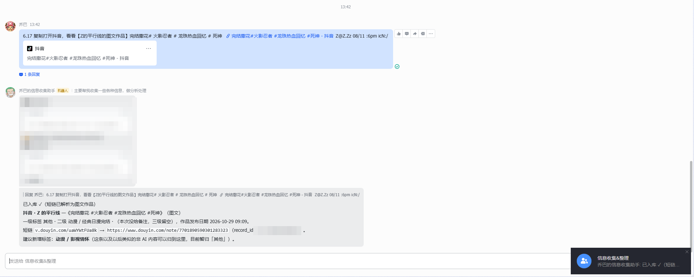
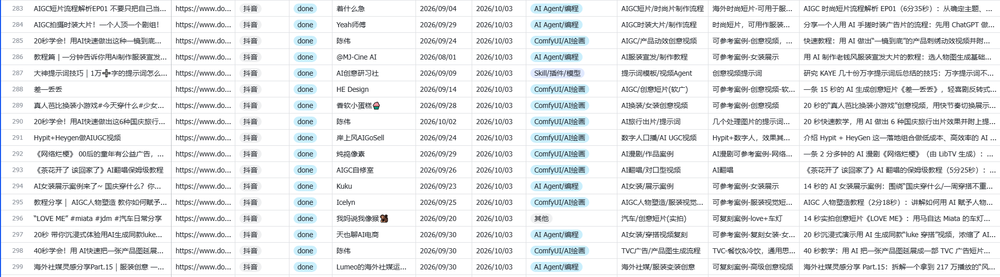
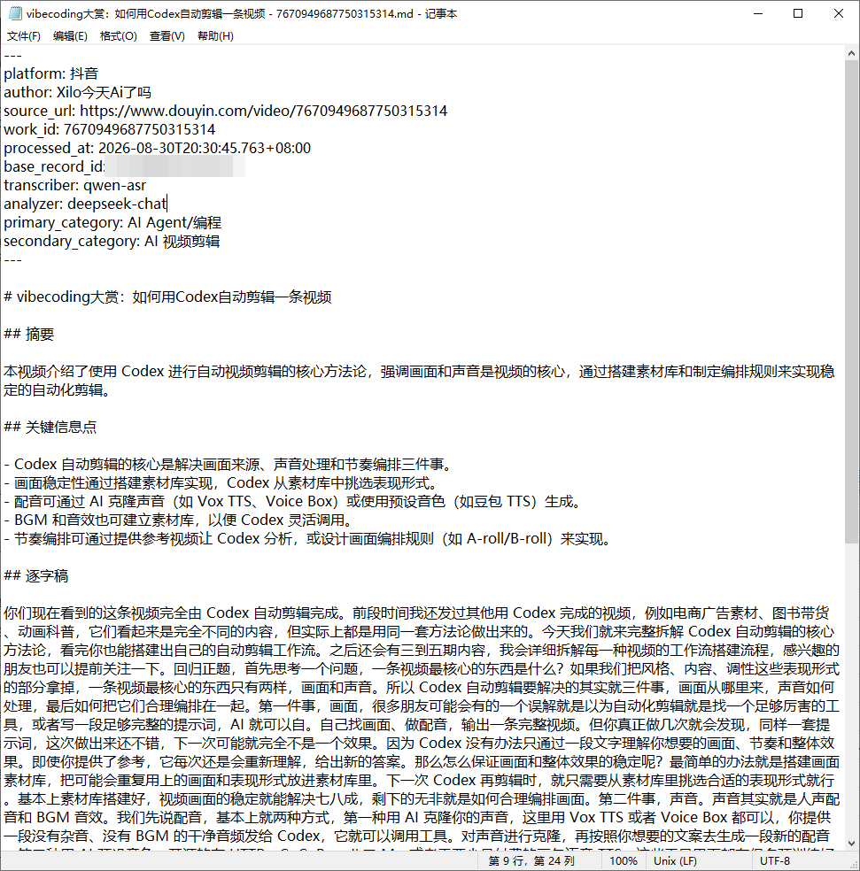
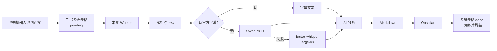

# xxsj-fs-ob

把你在各平台收藏的链接，自动变成 Obsidian 里的结构化知识笔记——发链接给飞书机器人，本机 Worker 下载、转写、AI 分析并归档。



*把链接发给飞书机器人，任务自动进入多维表格。*



*多维表格就是任务队列，处理完会回写状态和笔记路径。*



*笔记直接落在你的 Obsidian vault，包含摘要、要点和逐字稿。*

---

## 它做什么

1. 你把抖音、B站、微信公众号、X 或 YouTube 的链接发给飞书机器人；
2. 机器人把链接写入飞书多维表格，生成一条 `pending` 任务；
3. 本地 Worker 领取任务，下载内容和媒体；
4. 有官方字幕时直接使用；否则调用 Qwen-ASR，失败回退本地 faster-whisper；
5. 用 AI 生成摘要、关键信息、分类和值得保存的信息；
6. 写入你的 Obsidian vault；
7. 回写多维表格：`处理状态=done`、`知识库路径`。



所有处理都在你自己的电脑上完成，API Key 和笔记不会上传到本项目。

### 链接怎么进入多维表格

推荐做法是接入一个类似 Hermes 的飞书机器人：机器人把你发的链接写进多维表格，你只需要发消息。也可以不接机器人，直接在多维表格里手动新增一行，填好 `原文链接`、`来源平台`、`标题`，把 `处理状态` 设为 `pending`，Worker 同样会领取。

---

## 平台支持

| 平台 | 状态 | 说明 |
|---|---|---|
| 抖音 | 支持 | 视频、图文（`/note/`）；文章 `/article/` 未验证；不支持 v.douyin.com 短链 |
| B站 | 支持 | BV/av 链接、b23.tv 短链、视频转写 |
| 微信公众号 | 支持 | `/s/` 文章与图片归档 |
| X（推特） | 支持 | 推文、t.co 短链、纯数字 ID、图片、视频 |
| YouTube | 部分支持 | 有官方字幕的视频稳定可用；无字幕视频受 CDN 限制，可能失败 |
| 小红书 | 未支持 | 不会领取此类任务 |

---

## 飞书多维表格字段

Worker 只写 4 个字段：`处理状态`、`知识库路径`、`处理时间`、`最近错误`。其余字段由上游（机器人或你）写入。表至少应包含以下 16 个字段，字段名需完全一致：

| 字段 | 类型 | 谁写 | 说明 |
|---|---|---|---|
| 标题 | 文本 | 上游 | 笔记文件名 |
| 原文链接 | 文本 | 上游 | 必填 |
| 来源平台 | 单选 | 上游 | `抖音` / `B站` / `微信公众号` / `X` / `YouTube` / `其他` |
| 作者 | 文本 | 上游 | 视频或文章作者 |
| 作品发布日期 | 日期 | 上游 | 用于排序 |
| 一级标签 | 单选 | 上游 | AI 分析的分类范围，直接读取该字段的选项 |
| 概述 | 文本 | 上游 | 原始简介或摘要 |
| 二级标签 | 文本 | 上游 | 上游写入或 AI 建议 |
| 去重ID | 文本 | 上游 | 建议 `<平台>:<作品ID>` |
| 处理状态 | 单选 | Worker | `pending` / `processing` / `draft_ready` / `done` / `failed` |
| 备注 | 文本 | 上游 | 可选说明 |
| 最近错误 | 文本 | Worker | 失败原因 |
| 处理时间 | 日期 | Worker | 最后处理时间 |
| 知识库路径 | 文本 | Worker | 生成的 Obsidian 笔记路径 |
| 收录日期 | 日期 | 上游 | 用于排序 |
| 三级标签 | 文本 | 上游 | 上游写入 |

`来源平台` 留空时按「抖音」处理；写「小红书」「其他」不会被领取。`一级标签` 的选项会在每轮开始时从表里读取，你增删选项后，AI 分析的分类会跟着变化；读取失败时回退到内置默认分类。

---

## 前置条件

- Windows 10/11
- Node.js 20+ 与 npm/pnpm
- Python 3.10+（本地转写需要）
- FFmpeg 与 ffprobe（加入 PATH）
- lark-cli（飞书命令行工具，加入 PATH）
- 自己的飞书自建应用 + 机器人 + 多维表格
- 一个 OpenAI 兼容的分析模型 API Key（如 DeepSeek）
- Obsidian vault

可选：阿里云 DashScope Key（Qwen-ASR，云端转写）；NVIDIA GPU（本地转写更快）。

---

## 最快安装：让 AI 助手帮你装

把下面这段发给 Codex 或 Claude Code，并把 GitHub 地址替换成当前仓库地址：

```text
请帮我安装这个 skill：
https://github.com/Chopper888/xxsj-fs-ob

要求：
1. 先阅读 README.md、SKILL.md 和 docs/安装部署与日常使用说明.md；
2. 把仓库克隆到本机一个固定位置，并安装依赖；
3. 根据我的客户端找到正确的 skill 目录（Codex 或 Claude Code），只安装一份；
4. 复制 .env.example 为 .env，但不要让我在聊天里发送任何密钥；
5. 运行 scripts/install.ps1 和 scripts/doctor.ps1；
6. 告诉我还需要我自己完成的飞书应用、机器人、Base 和 API Key 步骤；
7. 环境检查通过后暂停，不要擅自启动长期 Worker。
```

如果安装到项目目录本身，也可以直接在该目录使用，不需要复制到 skill 目录。

---

## 手动安装

```powershell
git clone https://github.com/Chopper888/xxsj-fs-ob.git
cd xxsj-fs-ob
pnpm install
Copy-Item .env.example .env
notepad .env
```

然后运行：

```powershell
.\scripts\install.ps1
.\scripts\doctor.ps1
```

`install.ps1` 会安装依赖、创建 `data` 目录、在缺少 `.env` 时从模板复制，并运行环境检查。

---

## 配置

所有配置都在项目根目录的 `.env`。模板里的每一项都有中文注释，主要必填项：

| 配置项 | 用途 |
|---|---|
| `FEISHU_BASE_TOKEN` | 飞书多维表格 Base token |
| `FEISHU_TABLE_ID` | 数据表 table id |
| `LARK_PROFILE` | lark-cli profile 名称 |
| `OBSIDIAN_VAULT_PATH` | Obsidian vault 绝对路径（必填，未填 Worker 不启动） |
| `LLM_API_KEY` | 分析模型 API Key |
| `LLM_BASE_URL` / `LLM_MODEL` | 分析模型地址与名称（如 DeepSeek） |
| `DASHSCOPE_API_KEY` | 可选，Qwen-ASR；不填走本地转写 |
| `XXSJ_HTTPS_PROXY` | 可选，代理；留空表示不使用 |

- 抖音、微信公众号、B站、飞书一般不需要代理；X、YouTube 通常需要。
- yt-dlp 的代理优先级：`YTDLP_PROXY` → `XXSJ_HTTPS_PROXY` → `HTTPS_PROXY`；都留空则不使用代理。
- 首次处理抖音前，运行 `npx tsx scripts/manual-login.ts` 扫码登录，登录态保存在 `.browser/douyin`。
- 完整字段说明见 `.env.example`。

飞书应用与多维表格的字段要求、权限配置见 `docs/飞书权限配置.md`。

---

## 日常使用

启动（双击或命令行）：

```text
start-xxsj-fs-ob-worker.cmd
```

Worker 在后台运行；再次双击会复用正在运行的 Worker。关闭监控窗口不会停止 Worker。

```powershell
# 单轮处理，处理完退出
.\scripts\run-once.ps1

# 只处理指定飞书 Record ID
.\scripts\run-once.ps1 -RecordIds "recxxxxxxxx"

# 查看状态 / 停止
.\scripts\status-worker.ps1
.\scripts\stop-worker.ps1
```

详细说明见 [docs/安装部署与日常使用说明.md](docs/安装部署与日常使用说明.md)。

### 视频演示

[B站视频演示](https://www.bilibili.com/video/BV1zU4g6eEBq/)

---

## 常见问题

**任务一直是 pending**

检查 Worker 是否运行、`来源平台` 是否是受支持的值、飞书权限是否正常、`lark-cli` 是否在 PATH。

**抖音提示不支持的短链**

本项目不支持 `v.douyin.com` 短链，请使用 `www.douyin.com/video/<ID>` 或 `/note/<ID>` 形式的链接。

**YouTube 无字幕视频失败**

无字幕视频需要下载音频并转写，受 YouTube CDN 限制，可能失败。优先选择有官方字幕的视频；需要代理时请正确配置 `XXSJ_HTTPS_PROXY`。

**X / YouTube 全部失败**

这两个平台通常需要代理。检查代理是否可用，并确认 `.env` 中的代理地址正确。

**转写失败，提示 faster_whisper 缺失**

```powershell
pip install faster-whisper
```

或配置 `DASHSCOPE_API_KEY` 使用云端转写。

**启动即退出，提示 OBSIDIAN_VAULT_PATH**

在 `.env` 填写 vault 绝对路径，例如 `D:\Obsidian\MyVault`。

更多错误见 [docs/故障恢复.md](docs/故障恢复.md)。

---

## 安全

- `.env`、`.browser/`、`cookies/`、`data/`、`logs/` 已在 `.gitignore` 中，不要提交。
- 不要在任何 Issue、截图、日志或聊天中公开 API Key、App Secret、Token、Base 标识或 cookie。
- 本项目不包含任何真实密钥、真实笔记或真实逐字稿。
- 请遵守各平台的服务条款与内容版权要求。

---

## 文档

- [安装部署与日常使用说明](docs/安装部署与日常使用说明.md)
- [运行与停止](docs/运行与停止.md)
- [故障恢复](docs/故障恢复.md)
- [Obsidian 目录说明](docs/Obsidian目录说明.md)
- [飞书权限配置](docs/飞书权限配置.md)
- [日志与缓存](docs/日志与缓存.md)
- [升级与回滚](docs/升级与回滚.md)

## 交流与反馈

使用中遇到问题、有功能建议，欢迎交流；也可以直接在 GitHub 提 Issue 或 PR。

| 微信（进交流群） | 公众号 |
|:---:|:---:|
|  |  |
| 加好友备注「**xxsj**」，拉你进群 | 关注获取更新和教程 |

## License

[MIT](LICENSE) © 2026 乔巴 (Chopper888)
