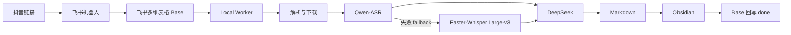

# xxsj-fs-ob

把平台内容自动变成自己的 Obsidian 知识资产。

飞书 → Base → Local Worker → ASR → DeepSeek → Obsidian

Turn shared content into structured knowledge.

[](https://github.com/Chopper888/xxsj-fs-ob/releases)
[](https://opensource.org/licenses/MIT)
[](https://github.com/Chopper888/xxsj-fs-ob/actions/workflows/ci.yml)
[](https://github.com/Chopper888/xxsj-fs-ob)
[](https://github.com/Chopper888/xxsj-fs-ob)
[](https://github.com/Chopper888/xxsj-fs-ob)

## 它解决什么问题

你把抖音链接发给自己的飞书机器人，后续的下载、转写、AI 分析、Obsidian 归档全部自动完成。不用手动复制、不用来回切换工具。

## 最终效果

**飞书多维表格**里可以看到每条任务的完整生命周期：

```
pending → processing → draft_ready → done
```

**Obsidian** 里自动生成结构化笔记：标题、作者、平台、原文链接、内容提要、完整逐字稿、AI 分类和「值得保存的信息」。

## 工作流程



## Quick Start

### 前置条件

- Windows 电脑
- Node.js、pnpm、Python 3.10+、FFmpeg
- 自己的飞书应用（含机器人 + 多维表格）
- Qwen（阿里云 DashScope）API Key
- DeepSeek API Key
- Obsidian

### 安装

```bash
git clone https://github.com/Chopper888/xxsj-fs-ob.git
cd xxsj-fs-ob
pnpm install
```

### 配置

```bash
cp .env.example .env
# 编辑 .env，填写飞书、Qwen、DeepSeek、Obsidian 等信息
```

详细部署说明见 [docs/安装部署与日常使用说明.md](docs/安装部署与日常使用说明.md)。

### 环境检查

```powershell
.\scripts\doctor.ps1
```

### 启动 Worker

双击项目根目录的：

```
start-xxsj-fs-ob-worker.cmd
```

或让 Codex 帮你：

> 请使用 xxsj-fs-ob 检查 Worker 状态。如果环境正常且 Worker 尚未运行，请启动 Worker。

### 触发任务

Worker 启动后，把你感兴趣的抖音链接发给自己的飞书机器人即可。剩下的事全部自动。

### 停止 Worker

```powershell
.\scripts\stop-worker.ps1
```

## 作为 Codex Skill 使用

本项目同时是一个 [Codex](https://openai.com/codex) Skill，可用于安装、检查、启动和维护。

安装方式见 [docs/安装部署与日常使用说明.md](docs/安装部署与日常使用说明.md)。

## 输入与输出示例

见 [examples/](examples/) 目录。全部使用合成数据，不含真实用户信息。

## Obsidian 最终笔记结构

```text
<标题> - <完整平台作品ID>.md
```

笔记包含：标题、作者、平台、发布时间、原始链接、内容提要、完整逐字稿、AI 分类、值得保存的信息。

## 支持平台

| 平台 | 状态 | 说明 |
|---|---|---|
| 抖音 | 正式支持 | v1.0.0 |
| 公众号 | 下一优先级 | 规划中 |
| B站 | Planned | 未实现 |
| YouTube | Planned | 未实现 |
| 推特 / X | Planned | 未实现 |
| 小红书 | Planned | 未实现 |

目录中存在不等于功能已实现。遇到未支持平台时，Worker 会明确拒绝而非伪装成成功。

## 质量与测试

```bash
pnpm typecheck    # TypeScript 类型检查
pnpm test         # 25 个测试文件，229 项测试
```

```powershell
.\scripts\validate-skill.ps1   # 项目校验
```

## 文档

完整文档索引见 [docs/README.md](docs/README.md)。

## Roadmap

见 [ROADMAP.md](ROADMAP.md)。

## Security

见 [SECURITY.md](SECURITY.md)。

公共仓库不得包含：`.env`、App Secret、API Key、Token、Cookie、个人飞书 App ID、Base 标识、Obsidian 绝对路径、真实视频、真实逐字稿和笔记。

## Contributing

见 [CONTRIBUTING.md](CONTRIBUTING.md)。

## License

MIT License。原作者：乔巴。

见 [LICENSE](LICENSE)。
