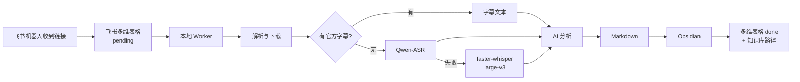

# xxsj-fs-ob

把你在各平台看到的链接，自动变成 Obsidian 里的结构化知识笔记。

**飞书机器人收链接 → 飞书多维表格排队 → 本地 Worker 下载/转写/AI 分析 → Obsidian 归档**

仅支持 **Windows 10/11**。所有处理都在你自己的电脑上完成，API Key 和笔记不会上传到本项目。

---

## 它做什么

1. 你把抖音、B站、微信公众号、X 或 YouTube 的链接发给自己的飞书机器人；
2. 机器人把链接写入飞书多维表格，生成一条 `pending` 任务；
3. 本地 Worker 自动领取任务，下载内容；
4. 有官方字幕时直接使用；否则调用 Qwen-ASR 转写，失败回退本地 faster-whisper；
5. 用 AI 生成摘要、关键信息、分类和值得保存的信息；
6. 写入你的 Obsidian vault；
7. 回写多维表格：`处理状态=done`、`知识库路径`。



---

## 平台支持

| 平台 | 状态 | 说明 |
|---|---|---|
| 抖音 | 支持 | 视频、图文（`/note/`）；不支持 v.douyin.com 短链 |
| B站 | 支持 | BV/av 链接、b23.tv 短链、视频转写 |
| 微信公众号 | 支持 | `/s/` 文章与图片归档 |
| X（推特） | 支持 | 推文、t.co 短链、纯数字 ID、图片、视频 |
| YouTube | 部分支持 | 有官方字幕的视频稳定可用；无字幕视频受 CDN 限制，可能失败 |
| 小红书 | 未支持 | 不会领取此类任务 |

多维表格的 `来源平台` 请统一写：`抖音`、`B站`、`微信公众号`、`X`、`YouTube`。

---

## 前置条件

- Windows 10/11
- Node.js 20+ 与 npm/pnpm
- Python 3.10+（本地转写需要）
- FFmpeg 与 ffprobe
- lark-cli（飞书命令行工具）
- 自己的飞书自建应用 + 机器人 + 多维表格
- 一个 OpenAI 兼容的分析模型 API Key（如 DeepSeek）
- Obsidian vault

可选：阿里云 DashScope Key（Qwen-ASR，云端转写）；NVIDIA GPU（本地转写更快）。

---

## 最快安装：让 AI 助手帮你装

把下面这段发给 Codex 或 Claude Code，并把 GitHub 地址替换成当前仓库地址：

```text
请帮我安装这个 skill：
https://github.com/Chopper888/xxsj-fs-ob

要求：
1. 先阅读 README.md、SKILL.md 和 docs/安装部署与日常使用说明.md；
2. 把仓库克隆到本机一个固定位置，并安装依赖；
3. 根据我的客户端找到正确的 skill 目录（Codex 或 Claude Code），只安装一份；
4. 复制 .env.example 为 .env，但不要让我在聊天里发送任何密钥；
5. 运行 scripts/install.ps1 和 scripts/doctor.ps1；
6. 告诉我还需要我自己完成的飞书应用、机器人、Base 和 API Key 步骤；
7. 环境检查通过后暂停，不要擅自启动长期 Worker。
```

如果安装到项目目录本身，也可以直接在该目录使用，不需要复制到 skill 目录。

---

## 手动安装

```powershell
git clone https://github.com/Chopper888/xxsj-fs-ob.git
cd xxsj-fs-ob
pnpm install
Copy-Item .env.example .env
notepad .env
```

然后运行：

```powershell
.\scripts\install.ps1
.\scripts\doctor.ps1
```

`install.ps1` 会安装依赖、创建 `data` 目录、在缺少 `.env` 时从模板复制，并运行环境检查。

---

## 配置

所有配置都在项目根目录的 `.env`。模板里的每一项都有中文注释，主要必填项：

| 配置项 | 用途 |
|---|---|
| `FEISHU_BASE_TOKEN` | 飞书多维表格 Base token |
| `FEISHU_TABLE_ID` | 数据表 table id |
| `LARK_PROFILE` | lark-cli profile 名称 |
| `OBSIDIAN_VAULT_PATH` | Obsidian vault 绝对路径（必填，未填 Worker 不启动） |
| `LLM_API_KEY` | 分析模型 API Key |
| `LLM_BASE_URL` / `LLM_MODEL` | 分析模型地址与名称 |
| `DASHSCOPE_API_KEY` | 可选，Qwen-ASR；不填走本地转写 |
| `XXSJ_HTTPS_PROXY` | 可选，代理；留空表示不使用 |

- 抖音、微信公众号、B站、飞书一般不需要代理；X、YouTube 通常需要。
- 首次处理抖音前，运行 `python scripts/manual-login.ts`（或 `npx tsx scripts/manual-login.ts`）扫码登录，登录态保存在 `.browser/douyin`。
- 完整字段说明见 `.env.example`。

飞书应用与多维表格的字段要求、权限配置见 `docs/飞书权限配置.md`。

---

## 日常使用

启动（双击或命令行）：

```text
start-xxsj-fs-ob-worker.cmd
```

Worker 在后台运行；再次双击会复用正在运行的 Worker。关闭监控窗口不会停止 Worker。

```powershell
# 单轮处理，处理完退出
.\scripts\run-once.ps1

# 只处理指定飞书 Record ID
.\scripts\run-once.ps1 -RecordIds "recxxxxxxxx"

# 查看状态 / 停止
.\scripts\status-worker.ps1
.\scripts\stop-worker.ps1
```

详细说明见 [docs/安装部署与日常使用说明.md](docs/安装部署与日常使用说明.md)。

---

## 输出

笔记写入：

```text
<OBSIDIAN_VAULT_PATH>\<OBSIDIAN_INBOX_DIR>\<平台>\<标题> - <作品ID后 8 位>.md
```

图片归档到同平台目录下的 `_assets\<哈希>\`。

笔记包含：标题、作者、发布时间、原文链接、AI 摘要、关键信息、原文/字幕/逐字稿、值得保存的信息。已有笔记内容被用户修改过时不会覆盖。

---

## 安全

- `.env`、`.browser/`、`cookies/`、`data/`、`logs/` 已在 `.gitignore` 中，不要提交。
- 不要在任何 Issue、截图、日志或聊天中公开 API Key、App Secret、Token、Base 标识或 cookie。
- 本项目不包含任何真实密钥、真实笔记或真实逐字稿。
- 请遵守各平台的服务条款与内容版权要求。

---

## 文档

- [安装部署与日常使用说明](docs/安装部署与日常使用说明.md)
- [运行与停止](docs/运行与停止.md)
- [故障恢复](docs/故障恢复.md)
- [Obsidian 目录说明](docs/Obsidian目录说明.md)
- [飞书权限配置](docs/飞书权限配置.md)
- [日志与缓存](docs/日志与缓存.md)
- [升级与回滚](docs/升级与回滚.md)

## License

作者：乔巴。使用前请先确认仓库内是否包含 LICENSE 文件。
